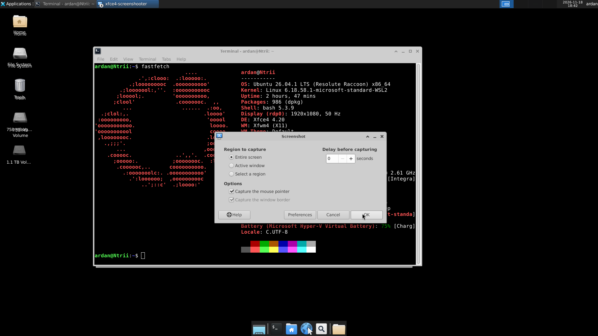

## Ubuntu WSL
Manual step to install Ubuntu in WSL and enable desktop manager
1. Enable Hyper-V to run Virtual Machine on a windows hardware device
* On your Windows, klick Start and type **Turn Windows Feature On or Off**
* Check **Hyper-V** and **Virtual Machine Platform**
2. Install WSL on Microsoft PowerShell
  Install WSL
  ```
  WSL --install
  ```
  Install Ubuntu
  ```
  WSL --install -d Ubuntu-26.04
  ```
3. Update and Installing Desktop Environment
   In your Ubuntu Termial, paste this script.
   ```
   bash -c "$(curl -fsSL https://raw.githubusercontent.com/knightofyardan/Ubuntu-WSL/master/ubuntu-setup.sh)"
   ```
   
4. Connect in Full Screen from Windows
- Press **Win + R** and type ```mstsc```
- Type ```127.0.0.1:3390``` in the Computer box, and click Connect.

